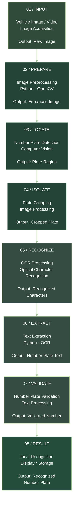
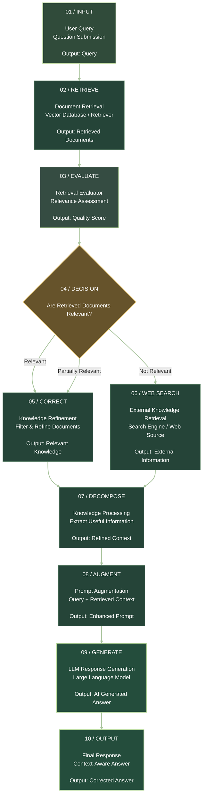

# 👋 Hi, I'm Rajnish Kumar

### Aspiring AI/ML Engineer | Python Developer

  
  
  
  

## 🚀 About Me

- 🎓 B.E. Student at University Institute of Technology, Burdwan University
- 💼 AI/ML Intern at National Informatics Centre (NIC), Kolkata
- 🤖 Interested in Artificial Intelligence and Machine Learning
- 👁️ Passionate about Computer Vision and AI applications
- 💻 Building practical projects using Python
- 🌱 Continuously learning new technologies

## 🛠️ Tech Stack

| Category | Technologies |
|---|---|
| Languages | Python, C, SQL |
| AI/ML | Machine Learning, LLMs |
| Computer Vision | OpenCV, OCR |
| Retrieval Systems | RAG, FAISS, Vector Embeddings |
| Core CS | Data Structures & Algorithms |

## 💡 Featured Projects

### 🚘 1. Automatic Number Plate Recognition (ANPR)

- Detects vehicle number plates using computer vision.
- Uses image preprocessing and OCR-based text extraction.
- Potential applications: parking management and traffic monitoring.

**Tech:** Python, OpenCV, OCR

# 🚘 Automatic Number Plate Recognition (ANPR)

  
  
  

## 01 / DATA FLOW

# The Recognition Pipeline

Follow the image from input to final number plate recognition.

## 02 / TECHNOLOGY STACK

| Technology | Purpose |
|---|---|
| Python | Core Programming |
| OpenCV | Image Processing |
| OCR | Text Recognition |
| NumPy | Numerical Operations |

## 03 / KEY FEATURES

- Vehicle Image Processing
- Number Plate Detection
- Image Preprocessing
- Plate Region Extraction
- Optical Character Recognition
- Number Plate Text Extraction
- Recognition Result Display

## 04 / PROJECT OBJECTIVE

The objective of this project is to develop an Automatic Number Plate Recognition system that detects vehicle number plates from images or video frames and extracts the alphanumeric characters using computer vision and OCR techniques.

## 05 / PROJECT WORKFLOW

Vehicle Input → Image Processing → Plate Detection → OCR → Text Extraction → Final Result

---

  <b>Developed by Rajnish Kumar</b> 
  Information Technology Engineering

### 📚 2. Corrective Retrieval-Augmented Generation (CRAG)

- Document-based question-answering application.
- Semantic search using FAISS and vector embeddings.
- Generates context-aware answers from document information.

**Tech:** LLMs, RAG, FAISS, Semantic Search

# 🧠 Corrective Retrieval-Augmented Generation (CRAG)

  
  
  
  

## 01 / DATA FLOW

# The CRAG Processing Pipeline

Follow the information flow from user query to a corrected, context-aware AI response.

## 02 / TECHNOLOGY STACK

| Technology | Purpose |
|---|---|
| Python | Core Programming |
| LangChain / LangGraph | RAG Workflow |
| Vector Database | Document Storage & Retrieval |
| Embeddings | Semantic Search |
| LLM | Response Generation |
| OCR / PDF Loader | Document Extraction |
| Web Search API | External Information Retrieval |

## 03 / KEY FEATURES

- Intelligent Document Retrieval
- Retrieval Quality Evaluation
- Relevant Document Filtering
- Corrective Retrieval Mechanism
- External Knowledge Search
- Context Refinement
- LLM-Based Answer Generation
- Context-Aware Responses

## 04 / PROJECT OBJECTIVE

The objective of Corrective Retrieval-Augmented Generation (CRAG) is to improve the reliability of Retrieval-Augmented Generation systems by evaluating the relevance of retrieved documents and correcting retrieval errors.

When retrieved information is insufficient or irrelevant, CRAG can use external knowledge sources to improve the context before generating the final response.

## 05 / WORKFLOW

User Query → Document Retrieval → Relevance Evaluation → Knowledge Correction → Context Augmentation → LLM Generation → Final Answer

## 06 / WHY CRAG?

| Traditional RAG | Corrective RAG |
|---|---|
| Retrieves documents | Evaluates retrieved documents |
| May use irrelevant context | Filters irrelevant information |
| Limited correction | Corrective retrieval mechanism |
| Context-based generation | Improved context-based generation |

---

  <b>Developed by Rajnish Kumar</b> 
  Information Technology Engineering

## 💼 Experience

**AI/ML Intern — National Informatics Centre (NIC)**

📍 Kolkata, West Bengal | March 2026 – Present

- Developed an ANPR system using Python and OpenCV.
- Implemented image preprocessing, plate detection and OCR-based text extraction.

## 🎓 Education

- **B.E.** — University Institute of Technology, Burdwan University (2023–2027)
- **Intermediate** — Raj Narayan College, Hajipur (2023)
- **Matriculation** — KCI Rajapakar, Hajipur (2021)

## 📊 GitHub Statistics

<!-- Replace YOUR_GITHUB_USERNAME with your GitHub username -->

## 🤝 Connect With Me

  
  
  

### ✨ "Keep Learning. Keep Building. Keep Growing."

<h2 align="center">🌐 Connect With Me</h2>

